# Отчёт по проекту DO1_Linux

Установка Ubuntu Server 24.04 LTS без графической оболочки в VirtualBox и настройка системы с нуля до рабочего состояния. Ниже — что было сделано на каждом шаге, с выводами команд.

## 1. Установка ОС

Установил систему из образа [Ubuntu 24.04.4 (Noble Numbat)](https://releases.ubuntu.com/24.04/ubuntu-24.04.4-live-server-amd64.iso) — серверная сборка без GUI.

Версию проверил через `cat /etc/issue`:

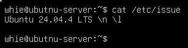  

## 2. Создание пользователя

Создал пользователя и сразу добавил его в группу `adm`:

```bash
sudo useradd -G adm user01
```

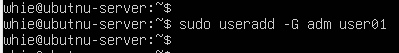  

Проверил членство в группе — `groups user01`:

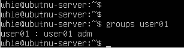  

Убедился, что учётная запись заведена — `cat /etc/passwd`:

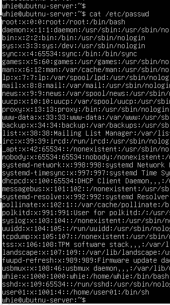  

## 3. Настройка сети

Задал имя машины `user-1`:

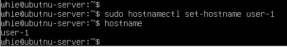  

Установил часовой пояс по текущему местоположению:

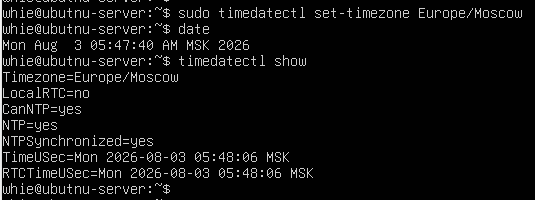  

Вывел список сетевых интерфейсов:

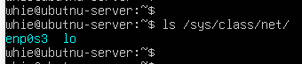  
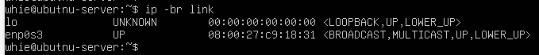  

> `lo` (loopback) — виртуальный сетевой интерфейс, который создаётся операционной системой и даёт возможность программам на одной машине «общаться» между собой через сетевые протоколы.

Получил адрес от DHCP-сервера:

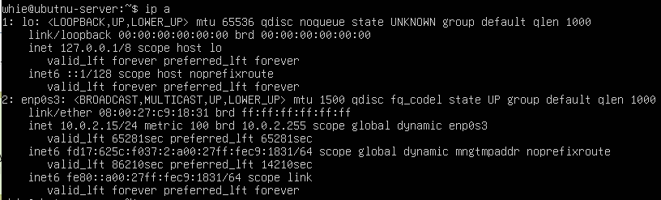  

> DHCP (Dynamic Host Configuration Protocol) — протокол динамической конфигурации хоста. Сетевой протокол, позволяющий хостам в сети получать автоматические сетевые настройки: IP-адрес, шлюз, маску подсети, DNS и т. д.

Определил внешний IP-адрес шлюза и внутренний адрес шлюза по умолчанию:

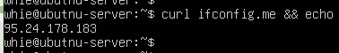  
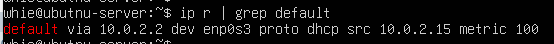  

Перевёл интерфейс на статическую конфигурацию (ip, gw, dns) — отредактировал `/etc/netplan/50-cloud-init.yaml`, в качестве DNS указал публичный сервер:

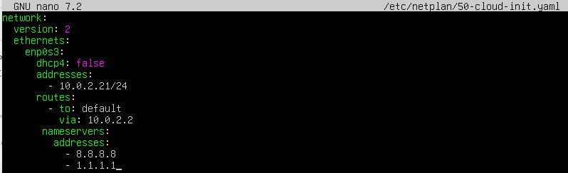  

После перезагрузки проверил, что настройки сохранились и соответствуют заданным:

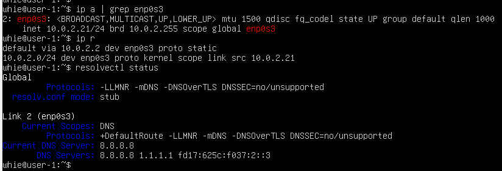  

Связь проверил пингом удалённых хостов `1.1.1.1` и `ya.ru` — 0% packet loss:

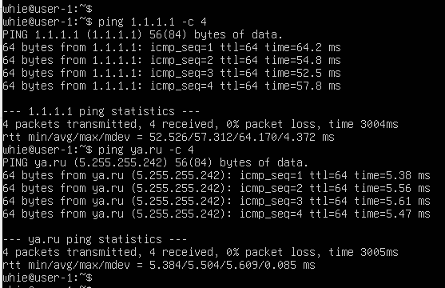  

## 4. Обновление системы

Обновил системные пакеты до актуальных версий. Повторный запуск команды обновления подтверждает, что доступных обновлений больше нет:

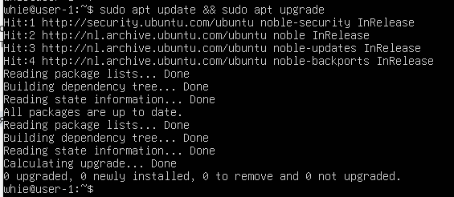  

## 5. Использование sudo

Выдал права sudo пользователю, созданному на шаге 2, и от его имени сменил hostname:

```bash
sudo passwd user01                 # задал пароль пользователю
sudo usermod -aG sudo user01       # добавил в группу sudo
su - user01                        # переключился на него
sudo hostnamectl set-hostname user01
hostname                           # проверил результат
```

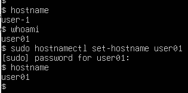  

**Назначение sudo.** `sudo` (superuser do) — команда, позволяющая обычному пользователю выполнять команды с правами другого пользователя (по умолчанию `root`). Это позволяет разграничить права доступа: пользователь работает без привилегий root в обычном режиме, но может временно получить их для конкретной команды. Список пользователей, которым разрешено использовать sudo, задаётся в файле `/etc/sudoers`.

## 6. Служба времени

Настроил автоматическую синхронизацию времени. Вывод `timedatectl show` содержит `NTPSynchronized=yes`, время соответствует установленному часовому поясу:

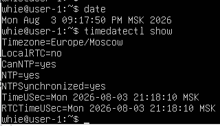  

## 7. Текстовые редакторы

Использовал три редактора: **vim**, **nano** и **micro** (первые два в Ubuntu Server есть из коробки, micro ставил через `sudo apt install micro`).

**Создание файла с сохранением изменений:**

- **vim** — `vim test_vim.txt` → `i` → текст → `Escape` → `:wq`

  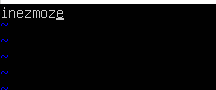  

- **nano** — `nano test_nano.txt` → текст → `Ctrl+O` → `Enter` → `Ctrl+X`

  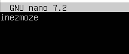  

- **micro** — `micro test_micro.txt` → текст → `Alt+G` → `Ctrl+S` → `Ctrl+Q`

  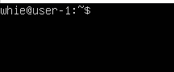  

**Выход без сохранения изменений:**

- **vim** — `Escape` → `:q!`

  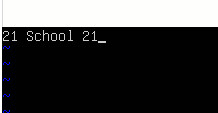  

- **nano** — `Ctrl+X` → `n`

  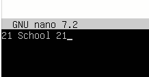  

- **micro** — `Alt+G` → `Ctrl+Q` → `n`

  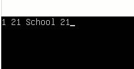  

**Поиск по содержимому и замена слова.** Искал слово `School`, менял его на `Ecole`.

- **vim**. Поиск: `/School`

    
    

  Замена: `:s/School/Ecole`

    
    

- **nano**. Поиск: `Ctrl+W` → `School` → `Enter`

  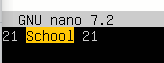  
    

  Замена: `Ctrl+\` → `School` → `Enter` → `Ecole` → `Enter` → `Y`

  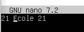  
  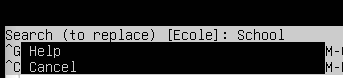  
    
    

- **micro**. Поиск: `Alt+G` → `Ctrl+F`

    

  Замена: `Ctrl+E` → `replace School Ecole` → `Enter` → `Y`

  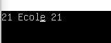  
  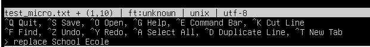  

## 8. Служба SSHD

Установил службу и добавил её в автозагрузку:

```bash
sudo apt install openssh-server -y
sudo systemctl enable ssh
```

**Перенос на порт 2022.** Отредактировал `/etc/ssh/sshd_config`: раскомментировал строку `#Port 22` и заменил её на `Port 2022`. После сохранения:

```bash
sudo systemctl daemon-reload      # systemd перечитывает конфигурационные файлы
sudo systemctl restart ssh.socket # сокет ssh перезапускается и начинает слушать порт 2022
```

Наличие процесса sshd проверил через `ps`:

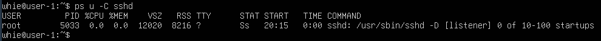  

- `ps` — показывает список запущенных процессов
- ключ `-C` — показывает процессы, указанные в cmdlist
- ключ `u` — отображает вывод в формате, ориентированном на пользователя

После перезагрузки системы (`reboot`) убедился, что служба слушает нужный порт — вывод `netstat -tan` содержит `tcp 0 0 0.0.0.0:2022 0.0.0.0:* LISTEN`:

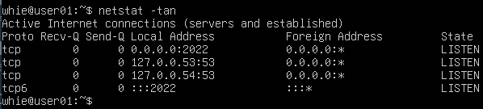  

**Разбор команды `netstat -tan`.** Программа выводит информацию о сетевых подключениях, таблицах маршрутизации и статистике интерфейсов.

- `-t` — показывает TCP-соединения
- `-a` — показывает все сокеты: и прослушиваемые (LISTEN), и непрослушиваемые. Без него выводятся только активные соединения, LISTEN скрыты
- `-n` — показывает числовые адреса вместо попытки определить символические имена хоста, порта или пользователя

**Столбцы вывода:**

- `Proto` — протокол сокета (tcp, udp, raw)
- `Recv-Q` — для ESTABLISHED: байты, полученные, но ещё не прочитанные программой. Для LISTEN: текущий размер очереди SYN-запросов
- `Send-Q` — для ESTABLISHED: байты, отправленные, но ещё не подтверждённые удалённым хостом. Для LISTEN: максимальный размер очереди SYN-запросов
- `Local Address` — адрес и порт локального конца сокета
- `Foreign Address` — адрес и порт удалённого конца сокета
- `State` — состояние сокета (LISTEN, ESTABLISHED, TIME_WAIT и др.)

`0.0.0.0` в адресе означает, что служба принимает подключения с любого IP.

## 9. Утилиты top и htop

Обе утилиты в системе уже были. По выводу `top` снял показатели:

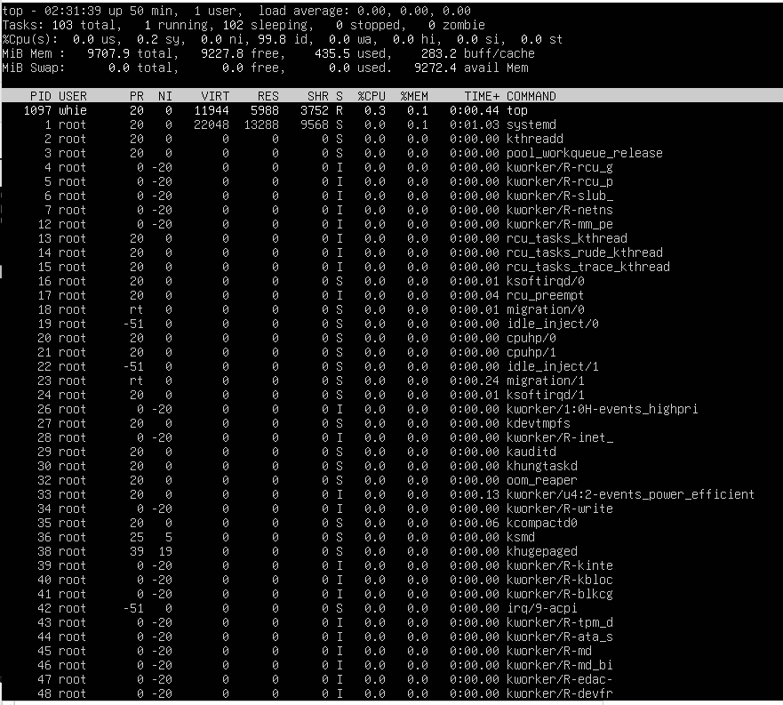  

- uptime — `50 минут`
- авторизованных пользователей — `1`
- средняя загрузка системы — `0.00 0.00 0.00` (за 1, 5 и 15 минут)
- процессов — `103` (1 запущен, 102 спят)
- загрузка CPU — `0.2%` (только `sy` — время работы процессов ядра)
- память — всего 9707.9 MiB, использовано `435.5 MiB`, свободно 9227.8 MiB, buff/cache 283.1 MiB
- больше всего памяти занимает — `PID 1` (systemd)
- больше всего процессорного времени занимает — `PID 1` (systemd)

Вывод `htop`:

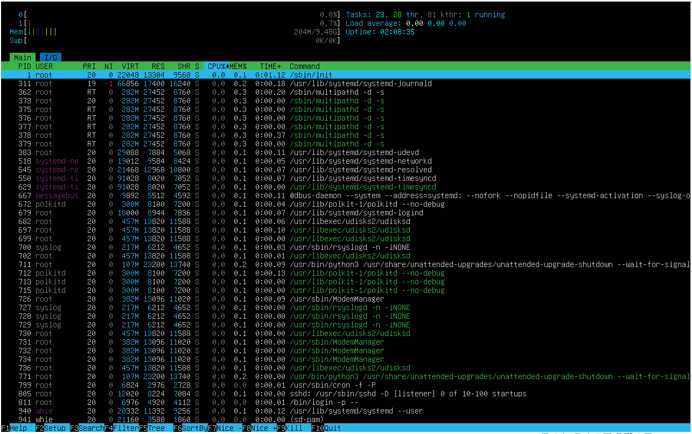  

Сортировка по PID, PERCENT_CPU, PERCENT_MEM и TIME:

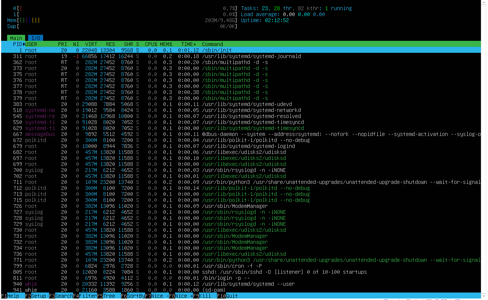  
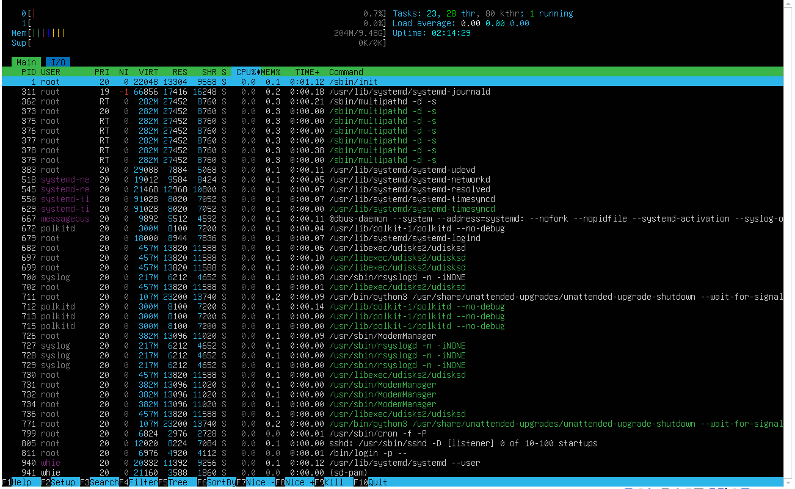  
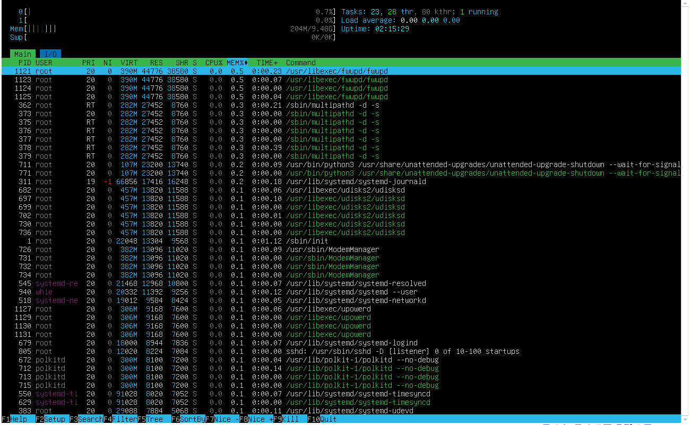  
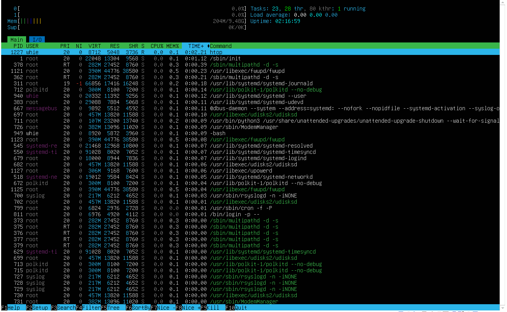  

Фильтр по процессу sshd:

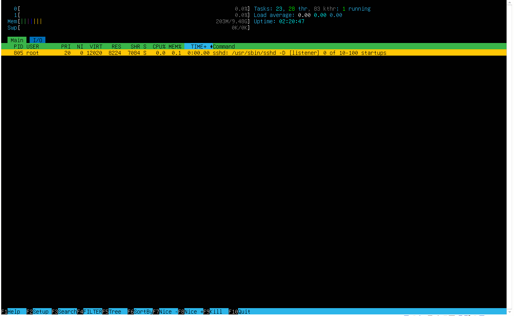  

Процесс syslog, найденный поиском:

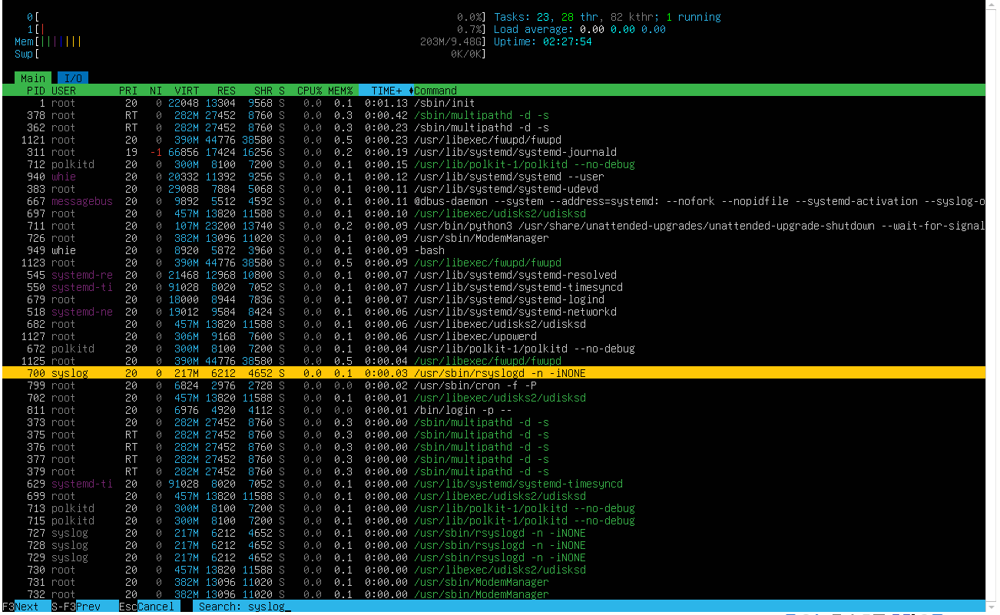  

Добавленный вывод hostname, clock и uptime:

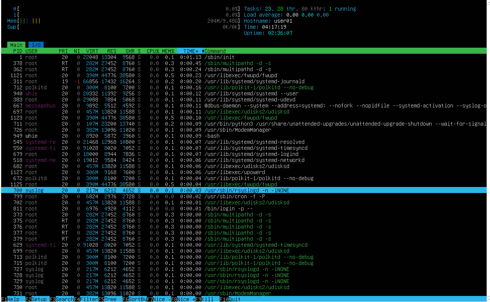  

## 10. Утилита fdisk

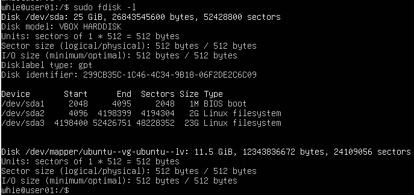  
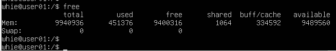  

- название диска — `/dev/sda`
- размер — `25 GiB`
- количество секторов — `52 428 800`
- swap — `отсутствует`

## 11. Утилита df

Вывод `df`:

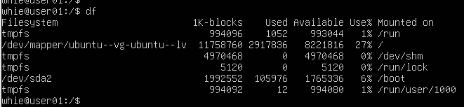  

Для корневого раздела `/`:

- размер раздела — `11 758 760`
- занято — `2 917 836`
- свободно — `8 221 816`
- использование — `27%`
- единица измерения в выводе — `кибибайты` (1K-blocks)

Вывод `df -Th`:

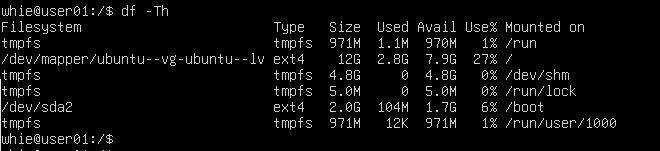  

- размер раздела — `12G`
- занято — `2.8G`
- свободно — `7.9G`
- использование — `27%`
- тип файловой системы — `ext4`

## 12. Утилита du

Общий вывод `du`:

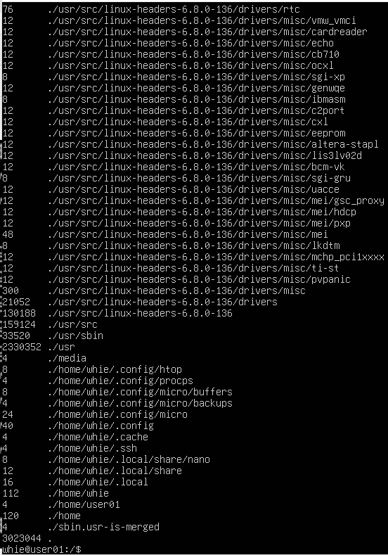  

Размер каталогов `/home`, `/var`, `/var/log` в байтах и в человекочитаемом виде:

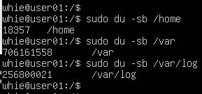  
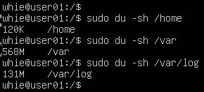  

Размер каждого вложенного элемента в `/var/log` (через `*`):

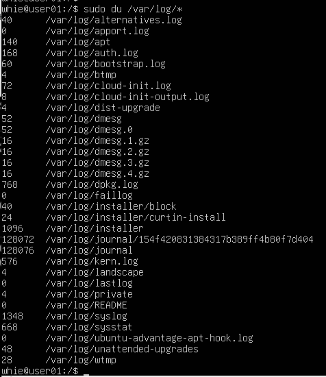  

## 13. Утилита ncdu

Поставил утилиту (`sudo apt install ncdu`) и посмотрел размер тех же каталогов — значения совпадают с полученными через `du`:

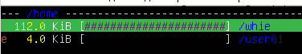  
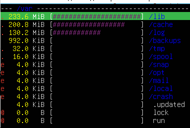  
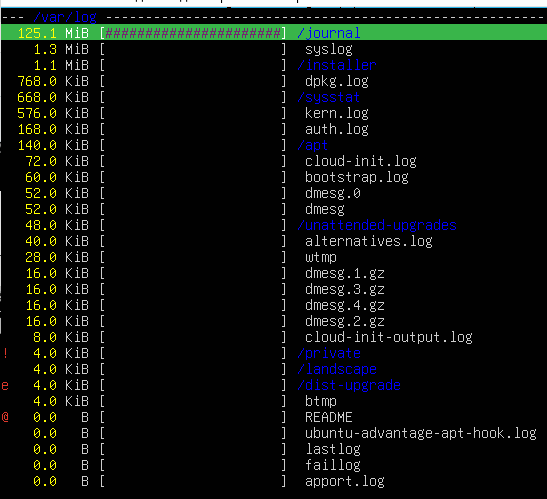  

## 14. Системные журналы

Смотрел журналы `/var/log/dmesg`, `/var/log/syslog` и `/var/log/auth.log`. Для чтения в реальном времени удобен `tail -f`, для просмотра файла целиком — `less`:

```bash
tail -f /var/log/dmesg
tail -f /var/log/syslog
tail -f /var/log/auth.log
```

Данные о последнем успешном входе нашёл командой `grep "pam" /var/log/auth.log | tail -10`:

  

- время последней успешной авторизации — `2026-08-05 21:03:33`
- имя пользователя — `whie`
- метод входа — `pam_unix(login:session)`, вход по паролю через консоль

Перезапустил службу SSHD (`sudo systemctl restart ssh`) и нашёл сообщение о рестарте в логах:

  

## 15. Планировщик CRON

Поставил в планировщик запуск `uptime` каждые 2 минуты и нашёл в системных журналах записи о выполнении, а также вывел список текущих заданий:

  
  

После проверки удалил все задания из планировщика — список пуст:

  
