# Отчёт по проекту DO2_LinuxNetwork

Настройка сетей в Linux на стенде из виртуальных машин: адресация и маски, статическая маршрутизация, сетевой экран на iptables, DHCP, NAT и SSH-туннели.

## 1. Адресация и маски (ipcalc)

### 1.1 Сети и маски

Адрес сети для `192.167.38.54/13` — `192.160.0.0/13`.

Перевод масок:

- `255.255.255.0` → префиксная `/24`, двоичная `11111111.11111111.11111111.00000000`
- `/15` → обычная `255.254.0.0`, двоичная `11111111.11111110.00000000.00000000`
- `11111111.11111111.11111111.11110000` → обычная `255.255.255.240`, префиксная `/28`

Минимальный и максимальный хост в сети `12.167.38.4` при разных масках:

- `/8` — HostMin `12.0.0.1`, HostMax `12.255.255.254`
- `11111111.11111111.00000000.00000000` — HostMin `12.167.0.1`, HostMax `12.167.255.254`
- `255.255.254.0` — HostMin `12.167.38.1`, HostMax `12.167.39.254`
- `/4` — HostMin `0.0.0.1`, HostMax `15.255.255.254`

### 1.2 localhost

У `localhost` адрес `127.0.0.1/8`, то есть петлевой интерфейс занимает всю сеть `127.0.0.0/8`. Обратиться к приложению на localhost можно с любого адреса из этого диапазона:

| IP адрес | Можно ли обратиться к localhost? |
| --- | --- |
| `194.34.23.100` | ❌ Нет |
| `127.0.0.2` | ✅ Да |
| `127.1.0.1` | ✅ Да |
| `128.0.0.1` | ❌ Нет |

### 1.3 Публичные и частные адреса

`RFC 1918` — стандарт Инженерной группы Интернета (IETF), определяющий диапазоны IP-адресов для частных (локальных) сетей. Включает три диапазона:

- `10.0.0.0/8` — 10.0.0.0 – 10.255.255.255
- `172.16.0.0/12` — 172.16.0.0 – 172.31.255.255
- `192.168.0.0/16` — 192.168.0.0 – 192.168.255.255

| IP адрес | Тип |
| --- | --- |
| 10.0.0.45 | Частный |
| 134.43.0.2 | Публичный |
| 192.168.4.2 | Частный |
| 172.20.250.4 | Частный |
| 172.0.2.1 | Публичный |
| 192.172.0.1 | Публичный |
| 172.68.0.2 | Публичный |
| 172.16.255.255 | Частный |
| 10.10.10.10 | Частный |
| 192.169.168.1 | Публичный |

### 1.4 Допустимые шлюзы в сети 10.10.0.0/18

Сеть `10.10.0.0/18` охватывает адреса от `10.10.0.0` до `10.10.63.255`. Шлюзом не могут быть:

- `10.10.0.0` — адрес сети
- `10.10.63.255` — широковещательный адрес
- адреса, не входящие в диапазон

| IP адрес | Может быть шлюзом |
| --- | --- |
| 10.0.0.1 | ❌ |
| 10.10.0.2 | ✅ |
| 10.10.10.10 | ✅ |
| 10.10.100.1 | ❌ |
| 10.10.1.255 | ✅ |

## 2. Статическая маршрутизация между двумя машинами

Стенд: две виртуальные машины `ws1` и `ws2` в разных сетях — `ws1` получает `192.168.100.10/16`, `ws2` — `172.24.116.8/12`.

### 2.1 Существующие сетевые интерфейсы

Посмотрел интерфейсы командой `ip a`:

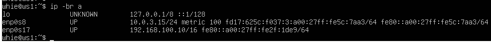  
*Сетевые интерфейсы ws1*

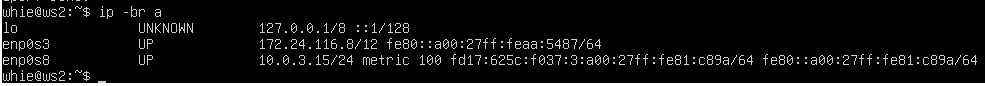  
*Сетевые интерфейсы ws2*

### 2.2 Настройка адресации через netplan

Отредактировал `/etc/netplan/00-installer-config.yaml` на обеих машинах:

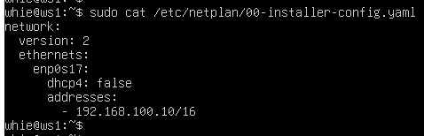  
*IP-адресация на ws1 — 192.168.100.10/16*

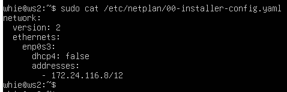  
*IP-адресация на ws2 — 172.24.116.8/12*

Применил конфигурацию командой `netplan apply`:

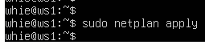  
*netplan apply на ws1*

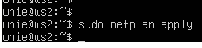  
*netplan apply на ws2*

### 2.3 Статический маршрут вручную (ip r add)

Добавил маршрут от одной машины до другой и обратно:

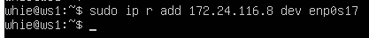  
*Добавление маршрута к ws2 на ws1*

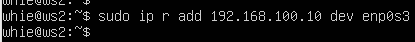  
*Добавление маршрута к ws1 на ws2*

Проверил связь пингом в обе стороны:

  
*Пинг ws2 с ws1*

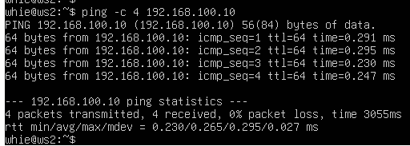  
*Пинг ws1 с ws2*

### 2.4 Статический маршрут с сохранением после перезагрузки

Маршрут, добавленный через `ip r add`, живёт до перезапуска. Чтобы он сохранялся, прописал его в `/etc/netplan/00-installer-config.yaml`:

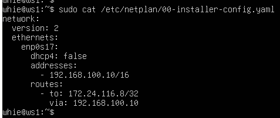  
*Маршрут в конфигурации netplan на ws1*

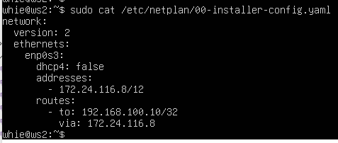  
*Маршрут в конфигурации netplan на ws2*

После перезагрузки связь сохранилась:

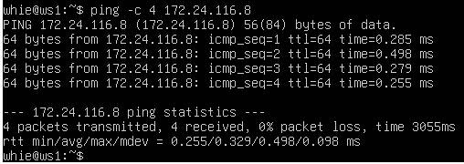  
*Пинг ws2 с ws1*

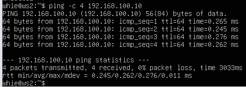  
*Пинг ws1 с ws2*

## 3. Замер пропускной способности (iperf3)

### 3.1 Перевод единиц

- 8 Mbps = 1 MB/s
- 100 MB/s = 800 000 Kbps
- 1 Gbps = 1000 Mbps

### 3.2 Измерение скорости между ws1 и ws2

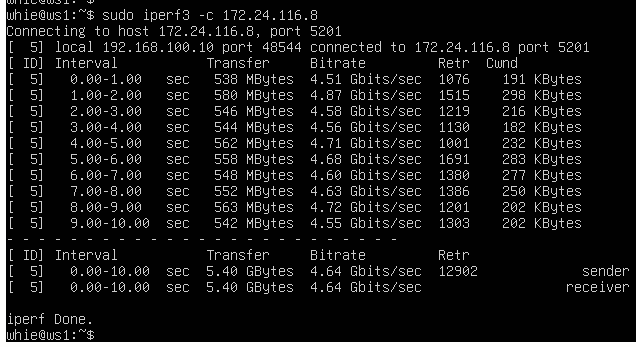  
*Измерение скорости, клиент ws1*

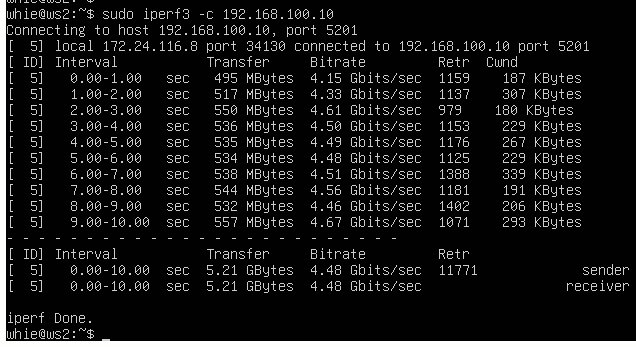  
*Измерение скорости, клиент ws2*

## 4. Сетевой экран (iptables)

### 4.1 Две стратегии написания правил

Собрал скрипт `/etc/firewall.sh` на обеих машинах: сброс правил таблицы `filter`, открытие портов 22 (ssh) и 80 (http), запрет и разрешение `echo reply`. Разница в том, в каком порядке идут запрещающее и разрешающее правила.

На `ws1` — сначала запрет, потом разрешение:

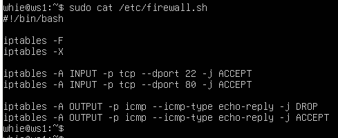  
*Правила фильтрации пакетов на ws1*

На `ws2` — сначала разрешение, потом запрет:

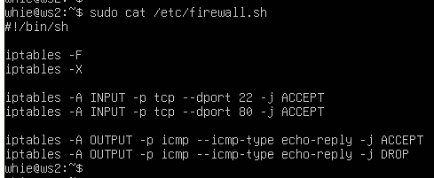  
*Правила фильтрации пакетов на ws2*

Запуск скриптов (`chmod +x /etc/firewall.sh` и `/etc/firewall.sh`):

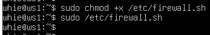  
*Запуск скрипта фильтрации на ws1*

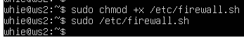  
*Запуск скрипта фильтрации на ws2*

**Разница стратегий.** Пакеты в правилах проверяются сверху вниз. На `ws1` первым идёт запрещающее правило для `echo reply`, поэтому разрешающее правило ниже уже не сработает. На `ws2` порядок обратный — первым срабатывает разрешающее. То есть правило, стоящее первым, не перезаписывается тем, что добавлено ниже, — в какую бы сторону ни работало.

### 4.2 Поиск «непингуемой» машины (nmap)

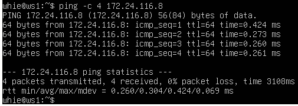  
*Пинг ws2 с ws1*

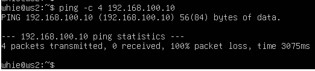  
*Пинг ws1 с ws2*

Машина `ws1` не пингуется — срабатывает запрет `echo reply`. Утилита `nmap` при этом показывает, что хост запущен (`Host is up`): она не полагается на ICMP, а проверяет отклик портов:

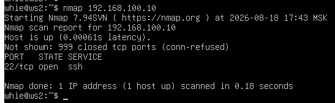  
*Вызов nmap на ws2*

## 5. Статическая маршрутизация сети из пяти машин

Стенд: три рабочие станции (`ws11`, `ws21`, `ws22`) и два маршрутизатора (`r1`, `r2`), три сети.

```
ws11 ─── r1 ─── r2 ─┬── ws21
                    └── ws22

ws11  10.10.0.2/18,  шлюз 10.10.0.1
r1    eth0 10.10.0.1/18    eth1 10.100.0.11/16
r2    eth0 10.100.0.12/16  eth1 10.20.0.1/26
ws21  10.20.0.10/26, шлюз 10.20.0.1
ws22  10.20.0.20/26, шлюз 10.20.0.1
```

### 5.1 Настройка адресов

Конфигурации в `/etc/netplan/00-installer-config.yaml` для каждой машины:

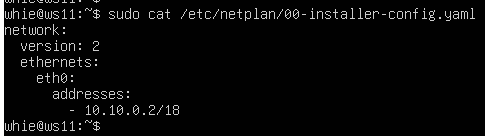  
*Конфигурация ws11*

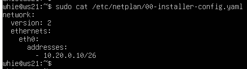  
*Конфигурация ws21*

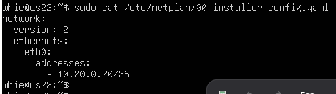  
*Конфигурация ws22*

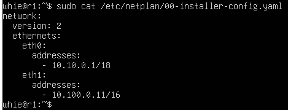  
*Конфигурация r1*

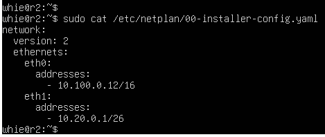  
*Конфигурация r2*

Перезапуск сервиса сети и проверка адресов через `ip -4 a`:

  
*Перезапуск сети и проверка адреса на ws11*

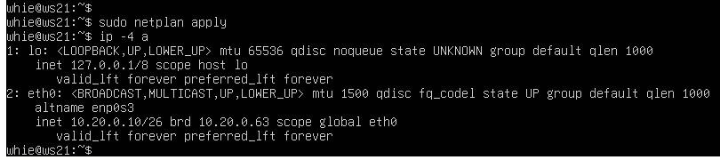  
*Перезапуск сети и проверка адреса на ws21*

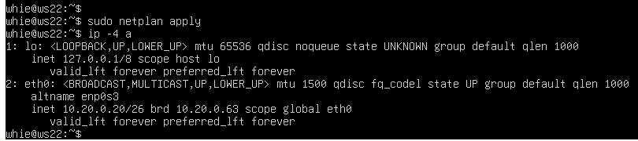  
*Перезапуск сети и проверка адреса на ws22*

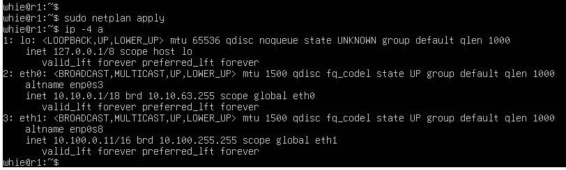  
*Перезапуск сети и проверка адреса на r1*

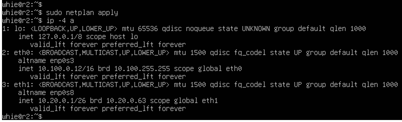  
*Перезапуск сети и проверка адреса на r2*

Проверка связи внутри сегментов:

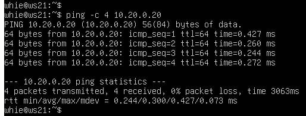  
*Пинг ws22 с ws21*

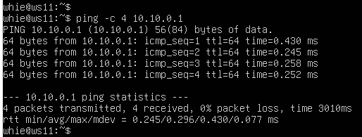  
*Пинг r1 с ws11*

### 5.2 Включение переадресации IP на маршрутизаторах

Временно, до перезагрузки — `sysctl -w net.ipv4.ip_forward=1`:

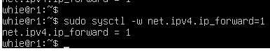  
*Включение переадресации на r1*

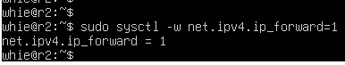  
*Включение переадресации на r2*

Постоянно — раскомментировал строку `net.ipv4.ip_forward=1` в `/etc/sysctl.conf`:

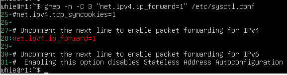  
*Переадресация на постоянной основе на r1*

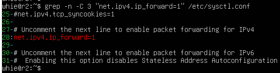  
*Переадресация на постоянной основе на r2*

### 5.3 Маршрут по умолчанию для рабочих станций

Добавил `default` перед адресом роутера в конфигурации netplan:

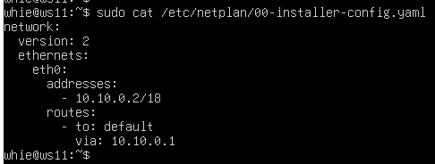  
*Маршрут по умолчанию на ws11*

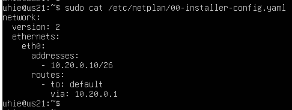  
*Маршрут по умолчанию на ws21*

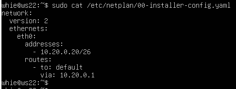  
*Маршрут по умолчанию на ws22*

Маршрут появился в таблице маршрутизации (`ip r`):

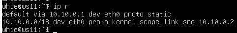  
*Таблица маршрутизации на ws11*

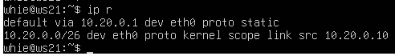  
*Таблица маршрутизации на ws21*

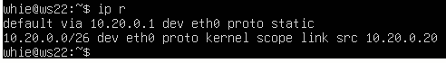  
*Таблица маршрутизации на ws22*

Проверил прохождение пакетов: пинг с `ws11` на `r2` и одновременный захват трафика на `r2` командой `tcpdump -tn -i eth0`:

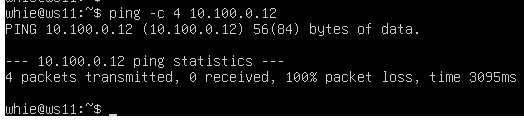  
*Пинг r2 с ws11*

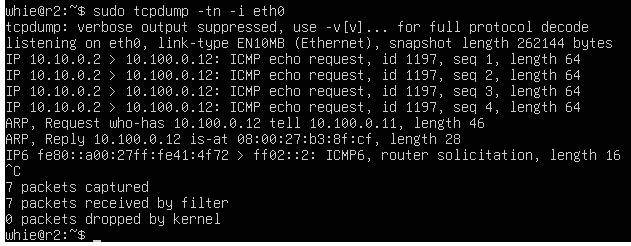  
*Пакеты на r2, интерфейс eth0*

### 5.4 Статические маршруты между маршрутизаторами

Прописал маршруты в конфигурации netplan на обоих роутерах:

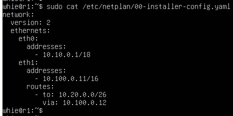  
*Статический маршрут в сеть 10.20.0.0/26 на r1*

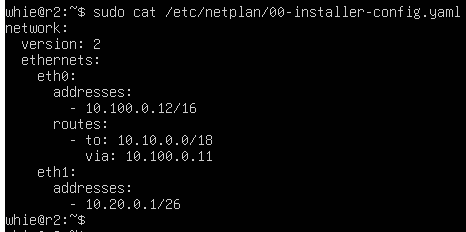  
*Статический маршрут на r2*

Таблицы маршрутизации после правки:

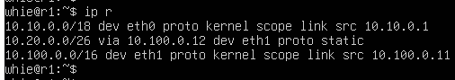  
*Таблица маршрутизации на r1*

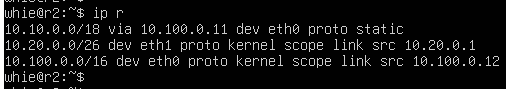  
*Таблица маршрутизации на r2*

Выборка маршрутов на `ws11`:

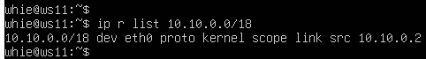  
*ip r list 10.10.0.0/18*

  
*ip r list 0.0.0.0/0*

**Почему для `10.10.0.0/18` выбран не маршрут по умолчанию.** Для адреса из этой сети подходят обе записи таблицы — и `10.10.0.0/18`, и `0.0.0.0/0`. Ядро применяет правило `longest prefix match`: выбирает маршрут с самой длинной маской, потому что он точнее описывает назначение. `/18` длиннее `/0`, поэтому побеждает.

### 5.5 Построение пути (traceroute)

Запустил на `r1` захват трафика `tcpdump -tnv -i eth0`:

  
*Захват трафика на r1*

И параллельно — `traceroute -q 1 -N 1 -m 4 10.20.0.10` с `ws11` до `ws21`:

  
*Traceroute от ws11 до ws21*

**Принцип работы traceroute.** Утилита не запрашивает маршрут у сети — она вычисляет его сама, используя поле TTL (Time To Live) в IP-заголовке.

По правилам IP каждый маршрутизатор при пересылке уменьшает TTL на единицу. Если TTL стал нулём, пакет уничтожается, а отправителю возвращается ICMP-сообщение Time Exceeded, в котором адресом источника стоит собственный адрес этого маршрутизатора. Traceroute намеренно ставит малый TTL, чтобы пакет «умер» на нужном узле, и по обратному ICMP узнаёт, кто именно его отбросил.

Из дампа на `r1` видно три последовательные пробы:

1. `TTL = 1`. Пакет 10.10.0.2 > 10.20.0.10 доходит до `r1`. Тот уменьшает TTL до нуля, отбрасывает пакет и отвечает 10.10.0.1 > 10.10.0.2: `ICMP time exceeded in-transit`. Определён первый узел пути — 10.10.0.1.
2. `TTL = 2`. `r1` уменьшает TTL до 1 и пересылает пакет дальше. `r2` получает его с TTL = 1, обнуляет и отвечает 10.100.0.12 > 10.10.0.2: `ICMP time exceeded in-transit`. Определён второй узел — 10.100.0.12.
3. `TTL = 3`. TTL хватает, чтобы пройти оба маршрутизатора, и пакет достигает `ws21`. Она является конечным получателем, поэтому вместо Time Exceeded возвращает 10.20.0.10 > 10.10.0.2: `ICMP udp port 33436 unreachable` — порт закрыт, так как traceroute намеренно обращается к неиспользуемому порту из диапазона 33434+.

Смена типа ICMP-сообщения служит признаком завершения: пока приходит Time Exceeded, traceroute увеличивает TTL и продолжает перебор; получение Port Unreachable означает, что достигнут адресат.

### 5.6 ICMP при маршрутизации на несуществующий адрес

Захват ICMP-трафика на `r1` командой `tcpdump -n -i eth0 icmp`:

  
*Захват ICMP-трафика на r1*

Пинг несуществующего адреса с `ws11` — `ping -c 1 10.30.0.111`:

  
*Пинг недоступного адреса с ws11*

## 6. Динамическая выдача адресов (DHCP)

### 6.1 Конфигурация службы DHCP на r2

В `/etc/dhcp/dhcpd.conf` задал пул адресов, маршрутизатор по умолчанию и DNS-сервер для внутренней сети:

  
*Файл /etc/dhcp/dhcpd.conf на r2*

В `resolv.conf` прописал `nameserver 8.8.8.8`:

  
*Файл resolv.conf на r2*

### 6.2 Проверка выдачи адреса

Перезапустил службу (`systemctl restart isc-dhcp-server`), перезагрузил `ws21` и проверил полученный адрес:

  
*Перезапуск DHCP-сервера на r2*

  
*Статус DHCP-сервера на r2*

  
*ws21 получил динамический адрес 10.20.0.2*

  
*Пинг ws22 с ws21*

### 6.3 Привязка адреса по MAC

На `ws11` в конфигурацию netplan добавил `macaddress: 10:10:10:10:10:BA` и `dhcp4: true`:

  
*MAC-адрес и dhcp4 на ws11*

### 6.4 DHCP на r1 с жёсткой привязкой к MAC

Настроил `r1` по аналогии с `r2`, но с выдачей адреса, закреплённого за MAC-адресом `ws11`:

  
*Файл /etc/dhcp/dhcpd.conf на r1*

  
*Файл resolv.conf на r1*

  
*Перезапуск DHCP-сервера на r1*

  
*Статус DHCP-сервера на r1*

  
*ws11 получил динамический адрес 10.10.0.2*

  
*Пинг ws22 с ws11*

### 6.5 Обновление аренды адреса

  
*Адрес ws21 до и после обновления*

Обновление выполнено командой `networkctl reconfigure eth0`: в Ubuntu 24.04 DHCP-клиент встроен в `systemd-networkd`, а пакет `isc-dhcp-client` с утилитой `dhclient` из дистрибутива исключён. Факт обновления виден по счётчику `valid_lft` — сброшен с 42148 до 43199 секунд.

**Какие опции DHCP при этом задействованы.** При запросе обновления клиент отправляет `DHCPREQUEST`, сервер отвечает `DHCPACK`, повторно передавая весь набор опций, заданных для подсети в `/etc/dhcp/dhcpd.conf`:

- `range` — пул адресов, из которого выдана аренда; адрес не изменился, так как сервер опознаёт клиента по MAC и продлевает существующую аренду;
- `option routers` — адрес шлюза по умолчанию, клиент прописывает его как `default via` в таблице маршрутизации;
- `option domain-name-servers` — адреса DNS-серверов, полученный DNS виден командой `resolvectl status`.

## 7. NAT

### 7.1 Публикация веб-сервера Apache

В `/etc/apache2/ports.conf` на `ws22` и `r1` заменил `Listen 80` на `Listen 0.0.0.0:80`, чтобы сервер принимал подключения не только с локального адреса:

  
*ports.conf на ws22*

  
*ports.conf на r1*

Запустил сервер командой `service apache2 start`:

  
*Запуск и статус apache2 на ws22*

  
*Запуск и статус apache2 на r1*

### 7.2 Запрет маршрутизации на r2

Собрал на `r2` скрипт файрвола: очистка таблиц `filter` и `nat` (`iptables -F`, `iptables -F -t nat`) и политика `FORWARD DROP` — отбрасывать все маршрутизируемые пакеты:

  
*Скрипт с запретом всех проходящих пакетов на r2*

  
*Запуск скрипта на r2*

Проверка: `ws22` с `r1` не пингуется — пакеты блокируются на маршрутизаторе:

  
*Пинг ws22 с r1 не проходит*

### 7.3 Разрешение ICMP

Добавил правило, разрешающее маршрутизацию пакетов ICMP:

  
*Правило для прохождения ICMP через r2*

  
*Запуск обновлённого скрипта на r2*

После этого пинг проходит:

  
*Пинг ws22 с r1 после разрешения ICMP*

### 7.4 SNAT и DNAT

**SNAT** — маскирование локальных адресов сети `10.20.0.0/26`, находящейся за `r2`. Кроме самого правила маскирования нужны ещё два: разрешить маршрутизацию исходящих пакетов из этой сети и разрешить обратный трафик уже установленных соединений.

```
iptables -t nat -A POSTROUTING -s 10.20.0.0/26 -o eth0 -j MASQUERADE
iptables -A FORWARD -s 10.20.0.0/26 -j ACCEPT
iptables -A FORWARD -m state --state ESTABLISHED,RELATED -j ACCEPT
```

**DNAT** — проброс порта 8080 на `r2` к веб-серверу Apache на `ws22`. Подключение извне создаёт новое TCP-соединение к 80-му порту `ws22`, поэтому отдельным правилом разрешается маршрутизация пакетов в состоянии `NEW`:

```
iptables -t nat -A PREROUTING -p tcp --dport 8080 -j DNAT --to-destination 10.20.0.20:80
iptables -A FORWARD -p tcp -d 10.20.0.20 --dport 80 -m state --state NEW -j ACCEPT
```

  
*Итоговый firewall.sh на r2*

  
*Запуск скрипта и правила в таблицах filter и nat на r2*

### 7.5 Проверка SNAT и DNAT

SNAT — подключение с `ws22` к Apache на `r1` командой `telnet 10.100.0.11 80`:

  
*Соединение с Apache на r1 со стороны ws22*

DNAT — подключение с `r1` к Apache на `ws22` через адрес `r2` и порт 8080: `telnet 10.100.0.12 8080`:

  
*Соединение с Apache на ws22 со стороны r1*

## 8. SSH-туннели (дополнительное задание)

Исходное состояние: на `r2` работает файрвол из части 7, а Apache на `ws22` слушает только петлевой интерфейс (`Listen localhost:80`) — то есть снаружи веб-сервер недоступен.

  
*Запуск firewall.sh и таблицы filter и nat на r2*

  
*Apache на ws22 настроен на localhost:80, служба запущена*

  
*Apache слушает только 127.0.0.1:80 — извне недоступен*

### 8.1 Local TCP forwarding (ws21 → ws22)

Порт `8021` на `ws21` проброшен на `localhost:80` веб-сервера на `ws22`:

  
*Установка SSH-туннеля с ws21 на ws22*

### 8.2 Remote TCP forwarding (ws22 → ws11)

Порт `8022` открыт на `ws11` и проброшен на `localhost:80` веб-сервера на `ws22`:

  
*Установка обратного SSH-туннеля с ws22 на ws11*

### 8.3 Проверка обоих туннелей

Проверял из второго терминала командой `telnet 127.0.0.1 <локальный порт>`.

  
*Проверка Local TCP forwarding на ws21: команды `who` и `tty` подтверждают работу во втором терминале, подключение к 127.0.0.1:8021 через туннель обслуживает Apache на ws22*

  
*Проверка Remote TCP forwarding на ws11: подключение к 127.0.0.1:8022 через обратный туннель обслуживает Apache на ws22. В выводе `who` видна входящая ssh-сессия pts/0 с адреса 10.100.0.12 (r2) — это и есть соединение с ws22, создавшее туннель*
