# 6. Анализ логов через GoAccess

- Установка GoAccess
  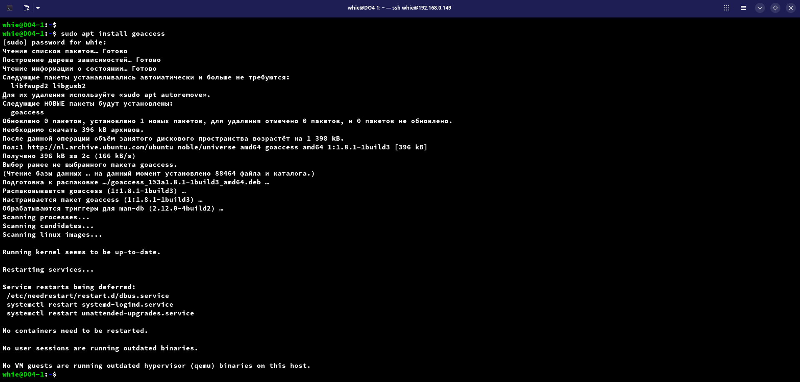

- Формируем логи nginx
  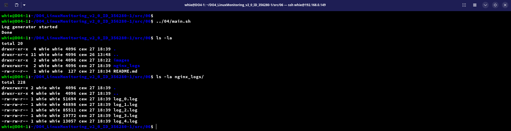

- Запустим GoAccess для отображения информации по логам
  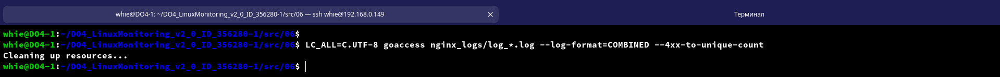

  - Информация по ошибкам (панель номер 13)
    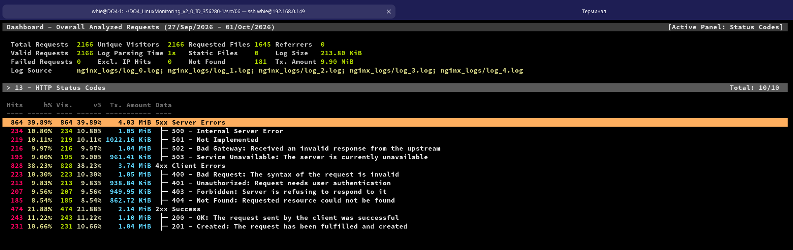

  - Информация по уникальным IP (панель номер 5)
    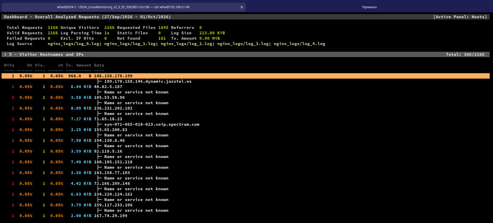
  
  - Информация по запросам с ошибками
    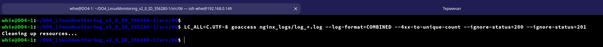
    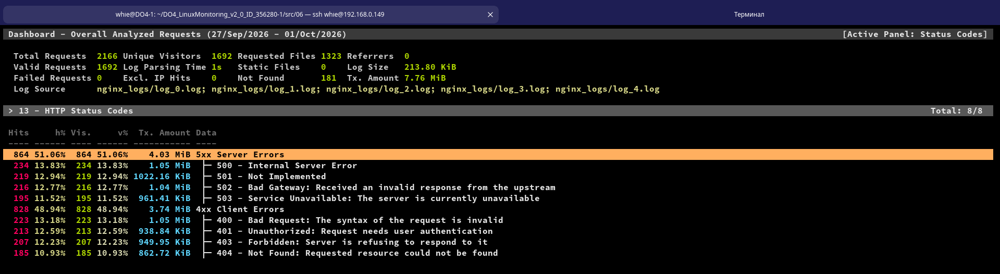

  - Информация по уникальным IP, которые встречаются среди ошибочных запросов (панель номер 5)
    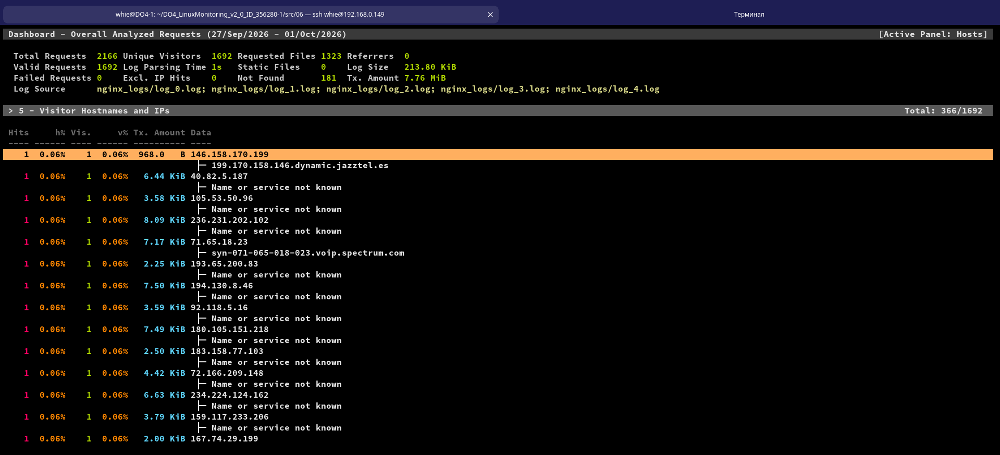

- Откроем веб-интерфейс на локальной машине  
  Так как мы запускаем все на ВМ в отчете будет показано как:
  1. сформировать отчет через GoAccess,
  2. запустить веб-сервер (обычный питоновский),
  3. пробросить порт через ssh-туннель
  4. посмотреть отчет GoAccess на основной локальной машине

1. Формируем отчет через GoAccess
   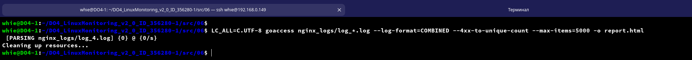

2. Запускаем веб-сервер
   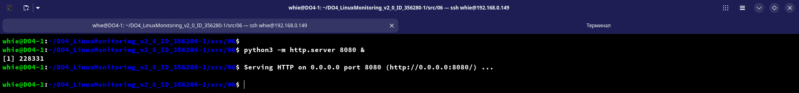

3. Проброс локального порта 8081 на порт 8080 виртуальной машины через SSH-туннель
   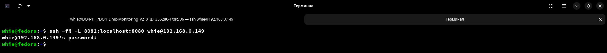

4. Веб-интерфейс GoAccess на основной машине
   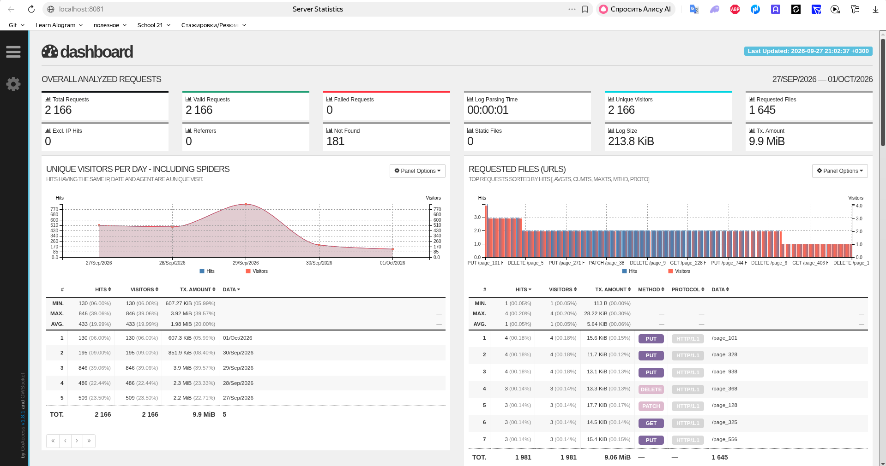

- Покажем туже информацию по ошибкам и IP в веб-интерфейсе
  
  - Информация по ошибкам
    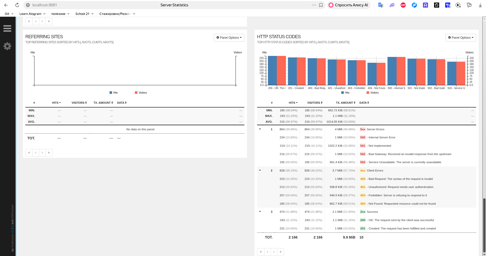

  - Информация по уникальным IP
    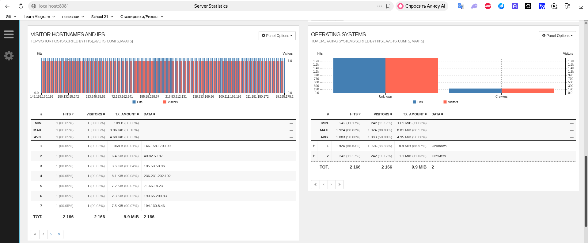

  - Информация по запросам с ошибками
    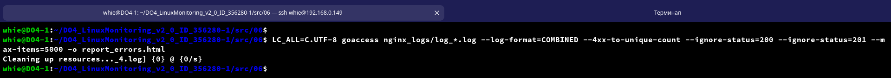
    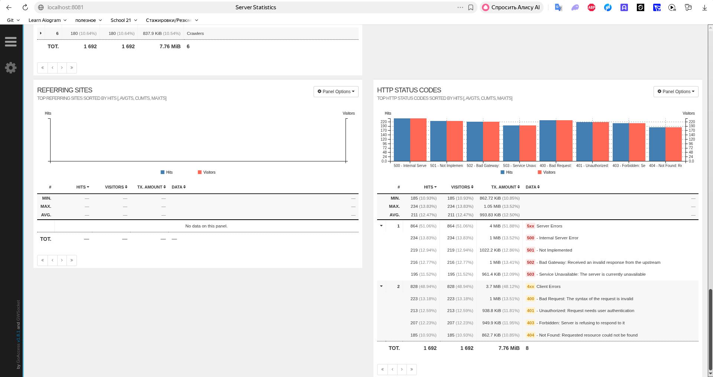

  - Информация по уникальным IP, которые встречаются среди ошибочных запросов
    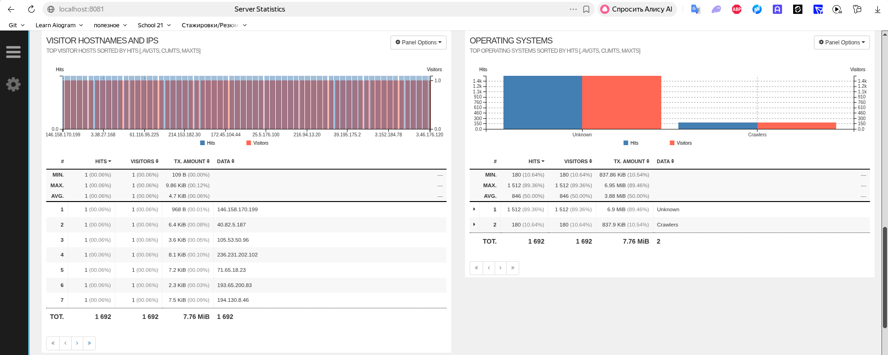
