# 7. Prometheus и Grafana

## Установка и настройка Prometheus

- Установка Prometheus:
  `sudo apt install -y prometheus`

- Проверка статуса
  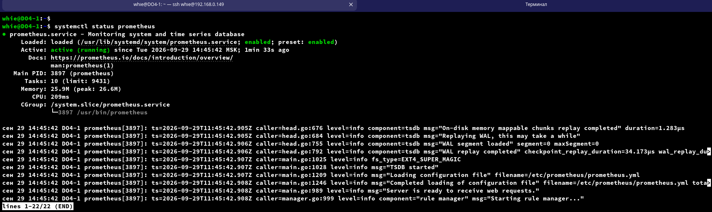

- Получим доступ к веб-интерфейсу Prometheus на своей локальной машине  
  `для этого на локальной машине пробросим порт 9090 на ВМ`  
  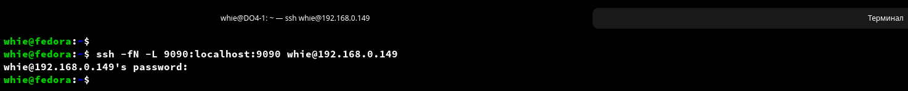  
  `зайдем в веб-интерфейс с локальной машины`  
  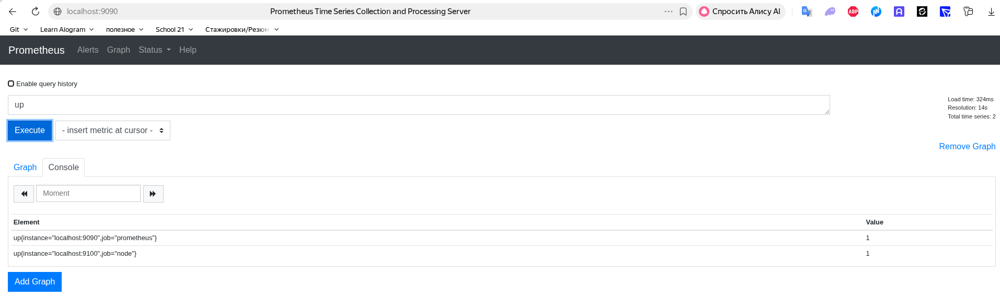  

## Установка и настройка Grafana

- Установка Grafana  
  `sudo apt-get install -y adduser libfontconfig1 musl`  
  `wget https://dl.grafana.com/grafana/release/13.2.3/grafana_13.2.3_36482603486_linux_amd64.deb`  
  `sudo dpkg -i grafana_13.2.3_36482603486_linux_amd64.deb`  

- Проверка статуса  
  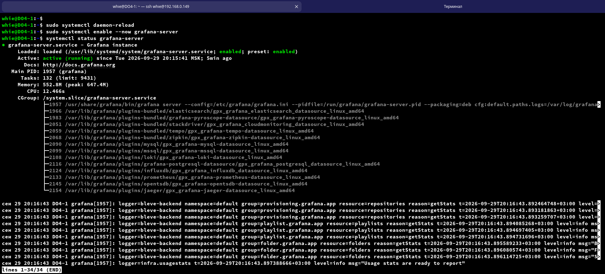  

- Получим доступ к веб-интерфейсу Grafana на своей локальной машине  
  `для этого на локальной машине пробросим порт 3000 на ВМ`  
  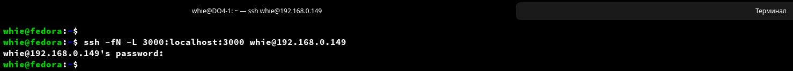  
  `зайдем в веб-интерфейс с локальной машины`  
  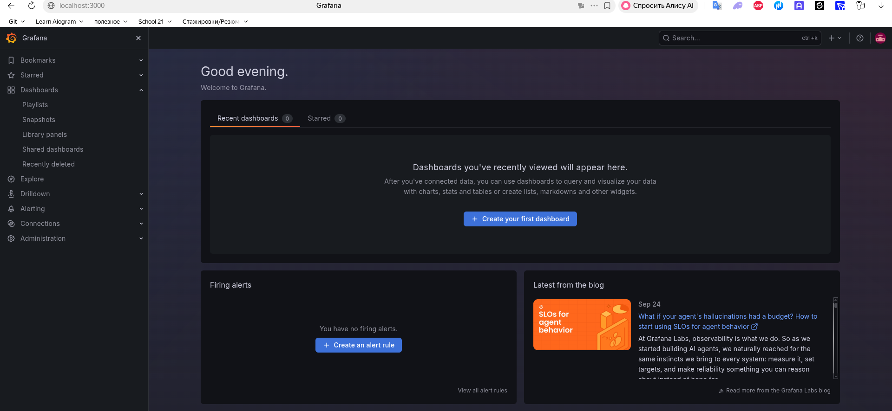  

- Дашборд `Grafana` отображающий ЦПУ, доступную оперативную память, свободное место и кол-во операций ввода/вывода на жестком диске  
  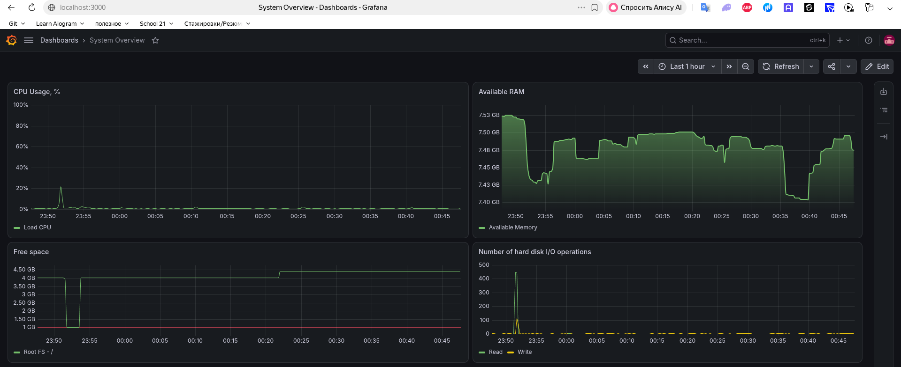  
  
## Тесты

- Запустим bash скрипт из части 2, чтобы посмотреть на нагрузку жесткого диска (место на диске и операции чтения/записи)  
  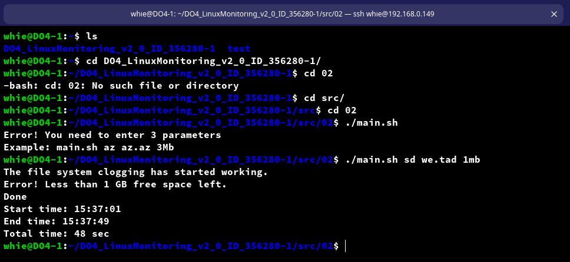

- Посмотрим как изменились показатели на дашборте в Grafana  
  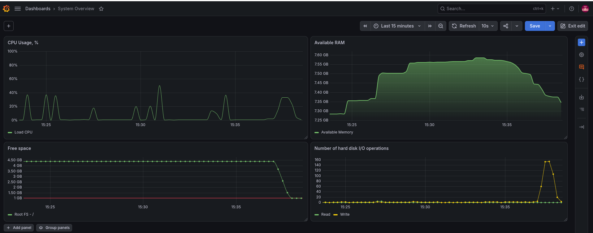  

- Проведем стресс-тест на ВМ  
  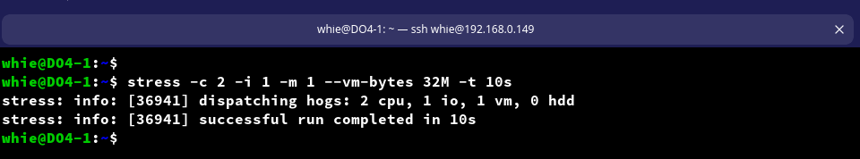

- Посмотрим как изменились показатели на дашборте в Grafana  
  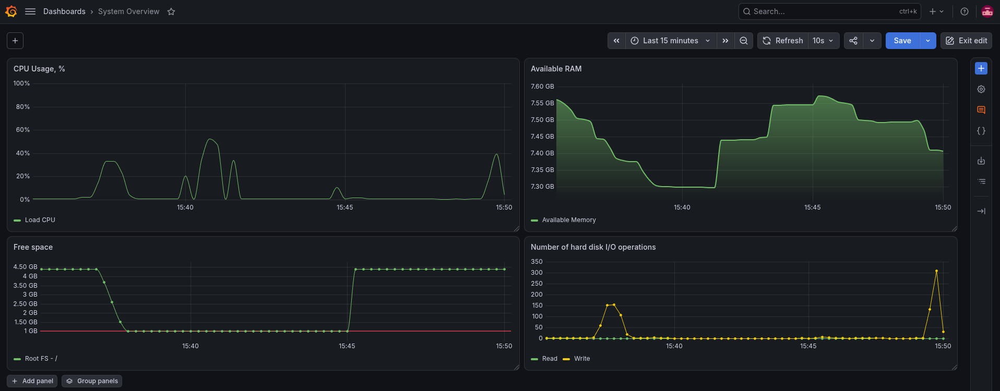  

`Не сильно видно нагрузку на систему, т.к. на виртуалке 8GB оперативной памяти и 4 процессора. Чтобы тест выглядел нагляднее:`  
  
- сузим окно времени в Grafana  
- увеличим параметры для стресс-теста: stress -c 4 -i 2 -m 2 --vm-bytes 512M -t 60s  

  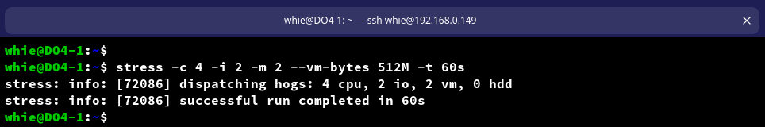
  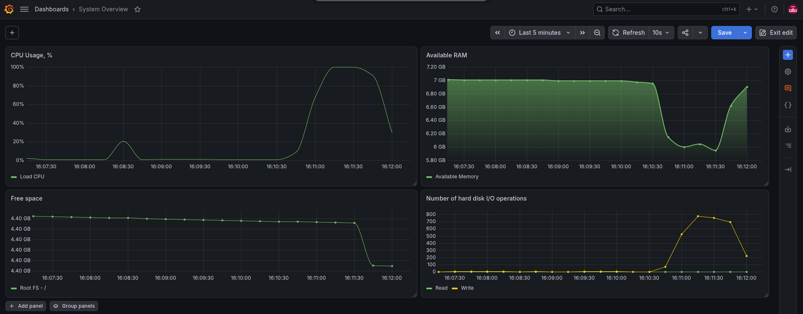