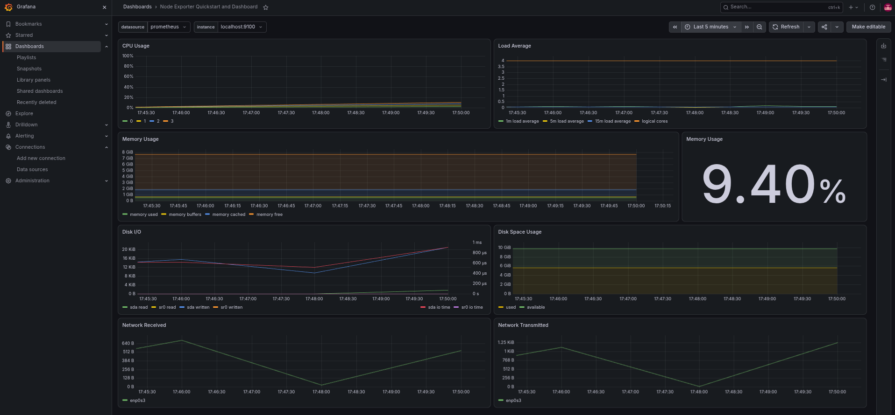
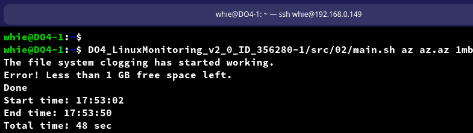
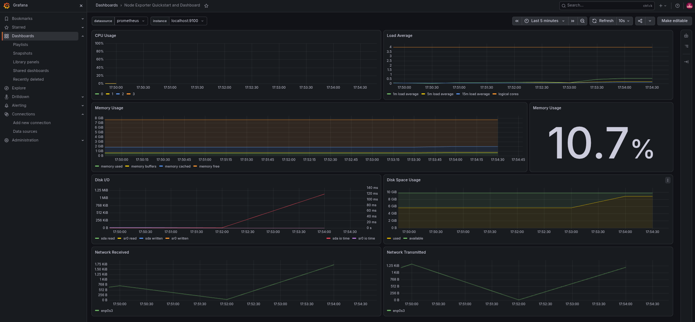
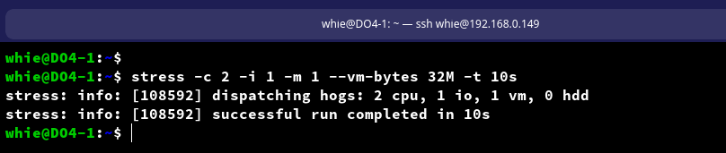
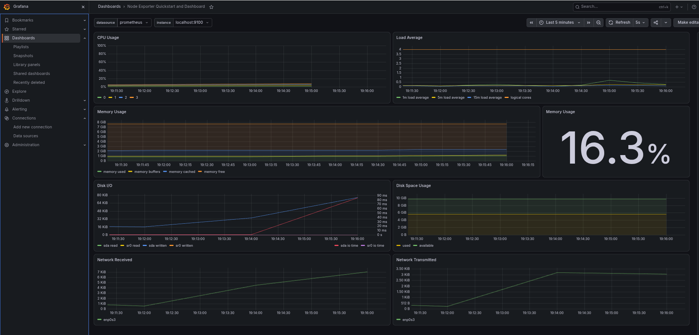
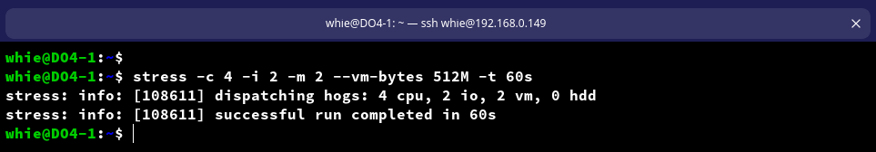
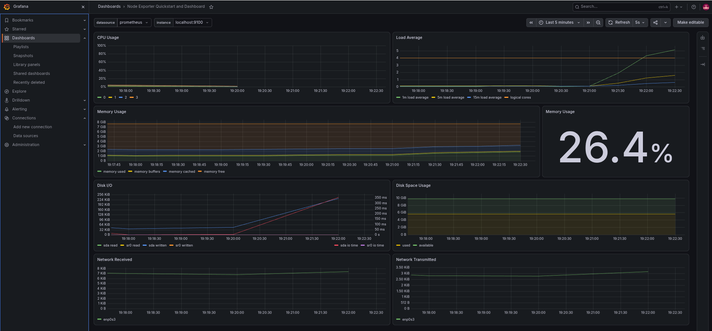
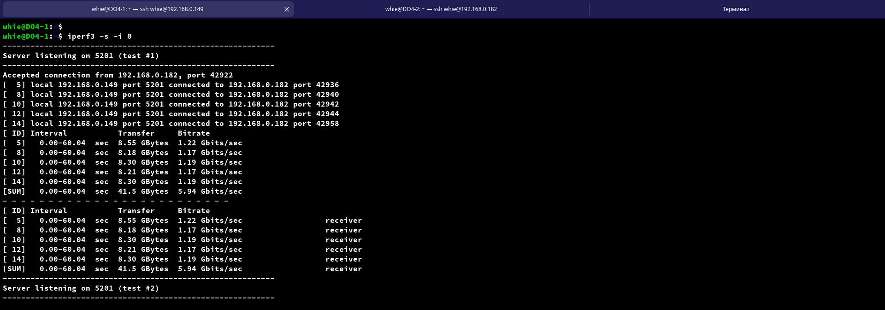
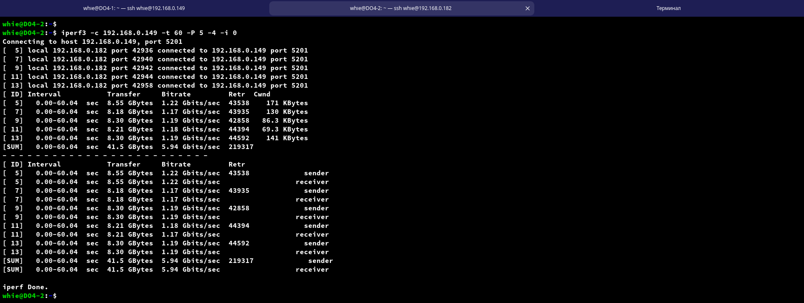
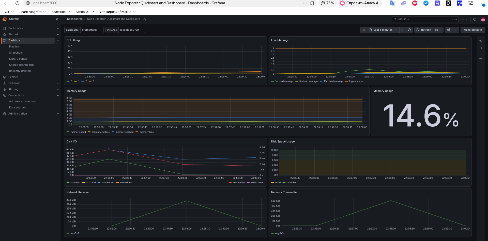

# 8. Готовый дашборд Node Exporter

## Добавление дашборда Node Exporter Quickstart and Dashboard с официального сайта Grafana Labs

- Скачаем json файл по ссылке: https://grafana.com/api/dashboards/13978/revisions/2/download
- Добавим дашборд: `Dashboards` -> `New` -> `Import Dashboard` -> `Upload dashboard JSON file` -> `Import`
    

## Тесты

- Запустим bash скрипт из части 2, чтобы посмотреть на нагрузку жесткого диска (место на диске и операции чтения/записи)  
  

- Посмотрим как изменились показатели на дашборте в Grafana  
  

- Проведем стресс-тест на ВМ  
  

- Посмотрим как изменились показатели на дашборте в Grafana  
  

`Не сильно видно нагрузку на систему, т.к. на виртуалке 8GB оперативной памяти и 4 процессора. Чтобы тест выглядел нагляднее:`  
  
- увеличим параметры для стресс-теста: stress -c 4 -i 2 -m 2 --vm-bytes 512M -t 60s  

  
  
  
- Проведем тест сетевого интерфейса  
  `На ВМ DO4-1 запустим iperf3 -s -i 0`  
  `На ВМ DO4-2 запустим iperf3 -c 192.168.0.149 -t 60 -P 5 -4 -i 0`  
  
    
    

- Итоги теста
    
    

- Показатели в дашборде Grafana  
    
