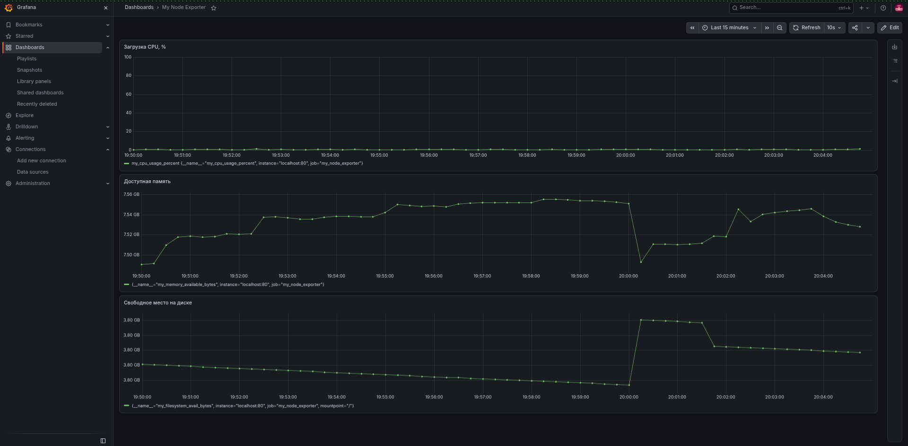
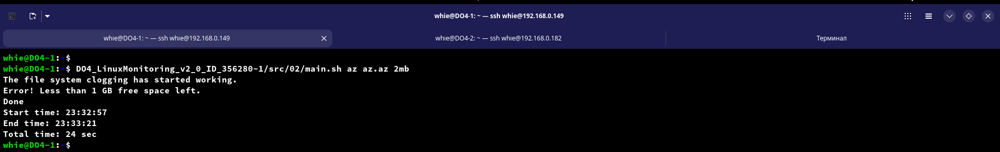
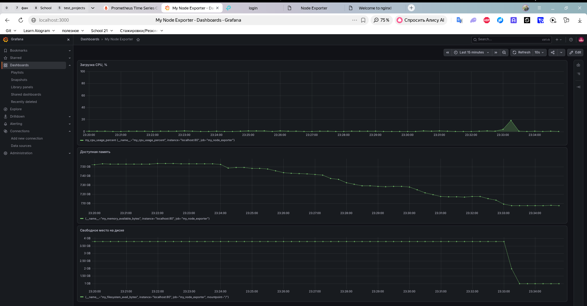
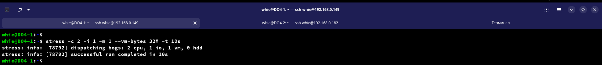
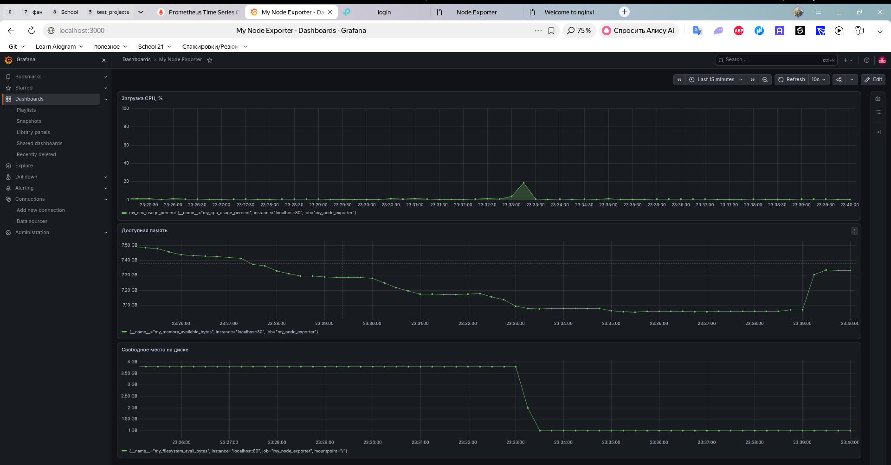
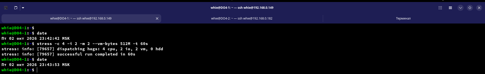
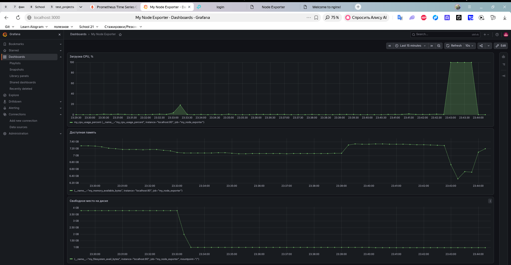

# 9. Собственный экспортёр метрик (дополнительное задание)

## Установка nginx

- Установим nginx:  
  `sudo apt install -y nginx`  

## Создание и запуск службы my_node_exporter

- Скопируем файл `my_node_exporter.sh` в `/usr/local/bin/` и сделаем исполняемым:  
  
  `sudo cp my_node_exporter.sh /usr/local/bin/`  
  `sudo chmod +x /usr/local/bin/my_node_exporter.sh`  

- Создадим службу. Для этого создадим файл `/etc/systemd/system/my_node_exporter.service:`
  
  ```ini
  [Unit]  
  Description=My node exporter for Prometheus (bash)  
 
  [Service]  
  ExecStart=/usr/local/bin/my_node_exporter.sh  
  Restart=always  
  User=root  
 
  [Install]  
  WantedBy=multi-user.target  
  ```

- Теперь запустим службу и добавим в автозагрузку:
  
  ```bash
  sudo systemctl daemon-reload
  sudo systemctl enable --now my_node_exporter
  ```

## Сбор Prometheusом данных от нашего my_node_exporter

- Добавим в конец конфига Prometheus `/etc/prometheus/prometheus.yml`  

  ```yaml
  job_name: my_node_exporter
    static_configs:
      - targets: ['localhost:80']
  ```

- Проверим и перечитаем конфиг:

  ```bash
  promtool check config /etc/prometheus/prometheus.yml
  sudo systemctl reload prometheus
  ```

## Дашборд Grafana

- Дашборд: ЦПУ, оперативная память, жесткий диск (объем)
    

## Тесты

- Скрипт из Part 2.
  
  - Запустим скрипт:

    

  - Данные с дашборда

      

- Стресс-тест

  - Запустим стресс-тест

      

  - Данные с дашборда

      

  - Запустим стресс-тест с другими параметрами  

    

  - Данные с дашборда  

    